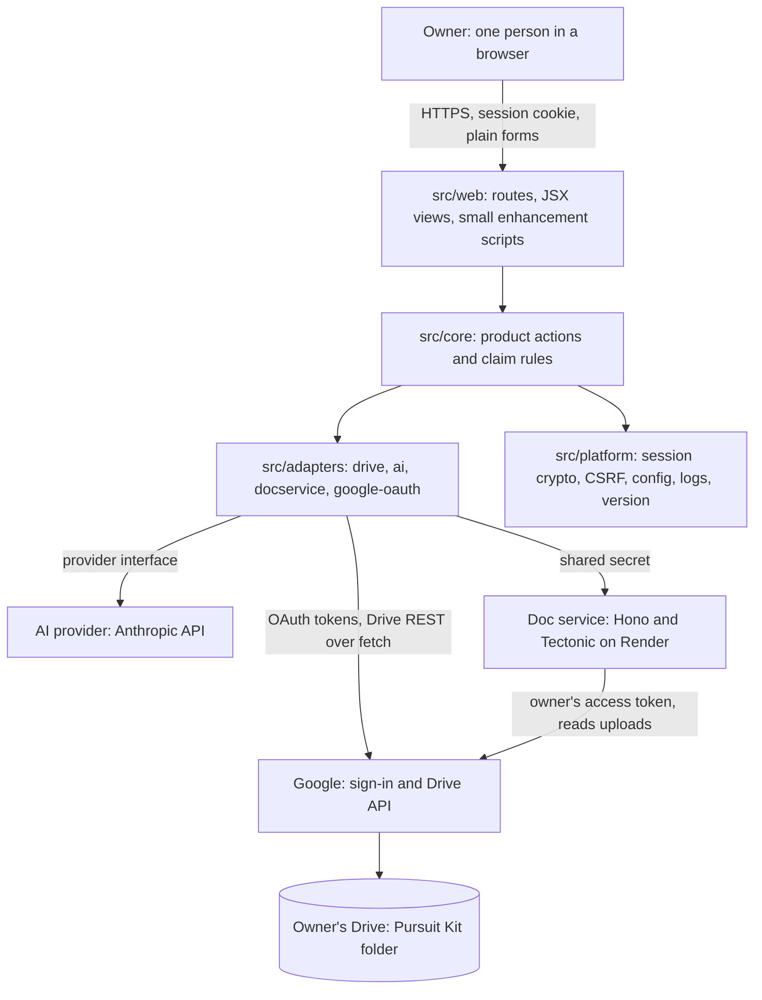
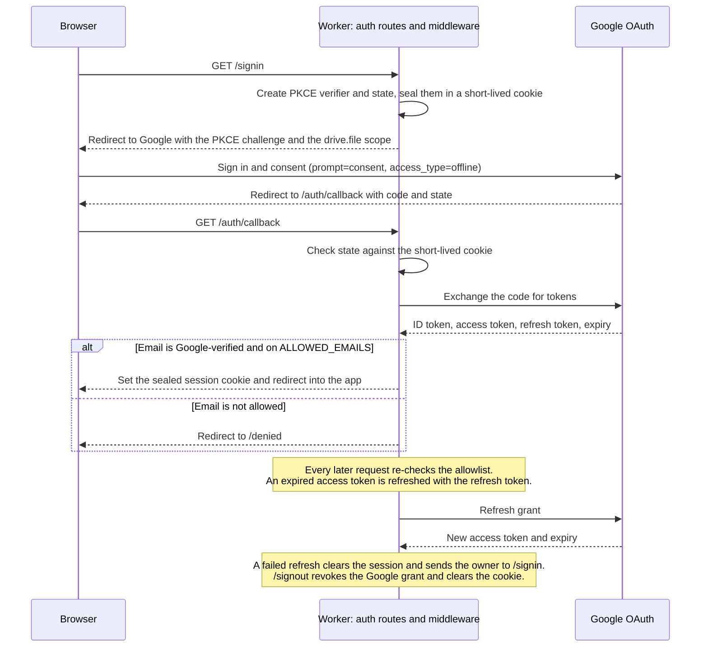
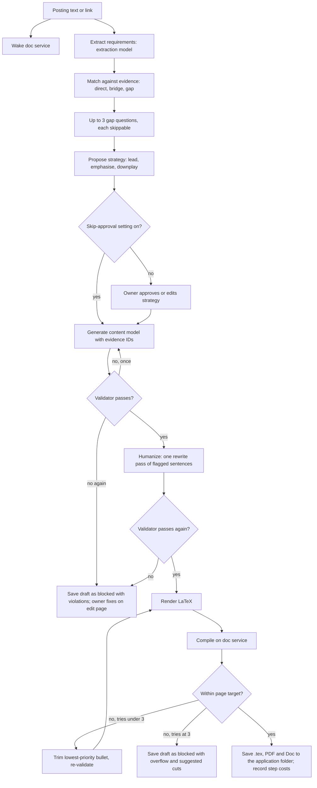
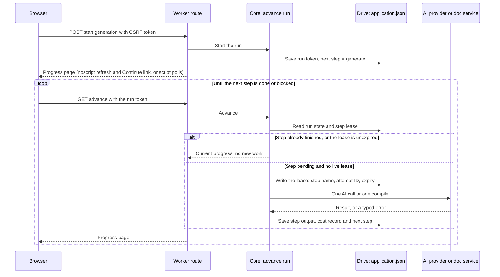
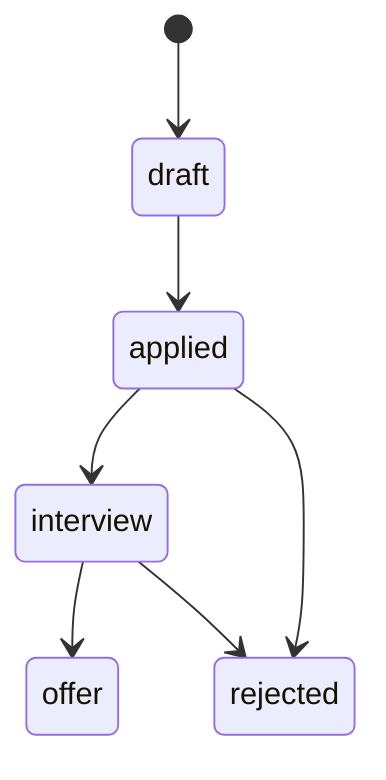
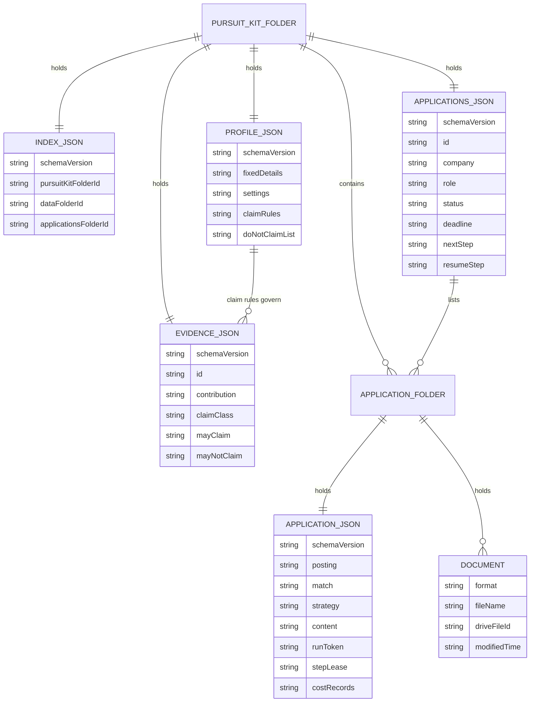
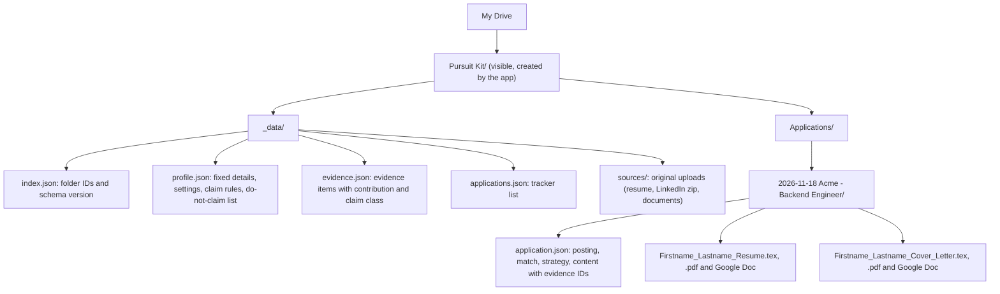
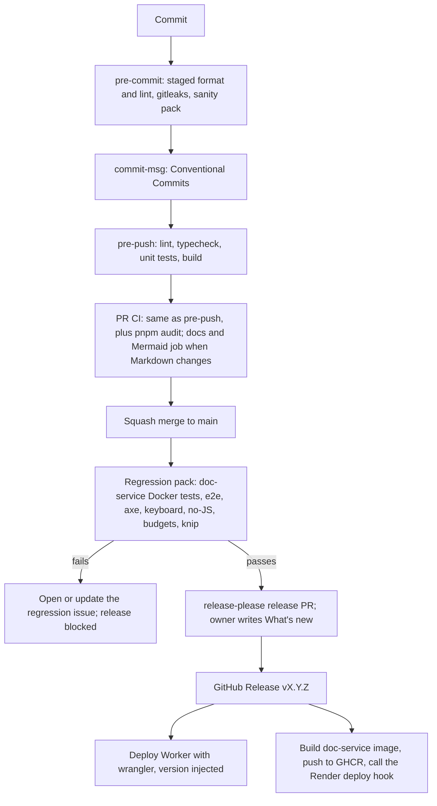
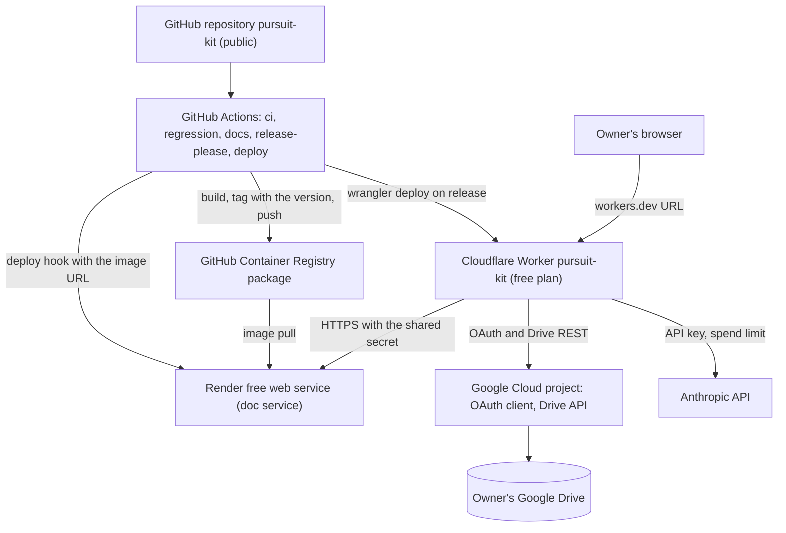

# Architecture

This page is the source of truth for the system's current shape. The diagrams use Mermaid only, so they render on GitHub and show up in review diffs. The plan and the ADRs link here instead of keeping their own copies.

**Status:** This describes the planned shape of the MVP, built by units U1–U10, as recorded in the [plan](plans/2026-11-18-1641-feat-pursuit-kit-mvp-plan.md). After U0 only the skeleton exists: a hello page on the Worker, a doc service that answers its health checks, and the hooks and workflows. Each diagram below names the unit that builds it. When a diagram and the code disagree, the code is ahead and this page is out of date.

The diagrams come from three places: the plan's High-Level Technical Design, the key technical decisions (KTD1–KTD15), and the ADRs. The list of nine is fixed by [ADR 0012](adr/0012-docs-and-mermaid-diagrams.md) and decision D28 in the [setup decisions](brainstorms/2026-11-18-technical-setup-decisions.md).

## 1. System context and containers

Shows who and what talks to the app, and where the CPU-heavy work runs. The app is a Hono Worker; almost all product work sits in `src/core/`; the outside services sit behind adapters. It serves the deployment shape in KTD1 (one Worker plus one doc service, both free, both allowing commercial use) and the core layer in [ADR 0013](adr/0013-core-product-layer.md). Built by U0, U1, U2, U3 and U4.

## 2. Google sign-in and token refresh

Shows the one sign-in path and what happens to an expired token on a later request. The run uses PKCE, a `state` check, offline access and a forced consent prompt, so the app always receives a refresh token. The allowlist is checked after the code exchange, against a Google-verified email, and again on every request. The session is an AES-GCM sealed cookie. Serves R1 and R21 (tokens stay server-side). See [ADR 0002](adr/0002-google-sign-in-allowlist-cookie-session.md) and KTD2. Built by U1.

## 3. Per-job pipeline with checks

Shows every step from a pasted posting to saved files, including where the claim validator, the humanize pass and the page-fit loop sit. This is the flow behind F2 and R10–R18. The validator is the accuracy guarantee, so it runs after generation and again after the humanize rewrite. A draft that still has violations is saved as blocked and opened on the edit page rather than shipped. The page-fit loop makes at most three trims. Serves R6, R7, R13, R15, R16 and the 10-minute target. See KTD4, KTD5 and KTD8. Built by U6, U7 and U8; editing returns through the same checks in U9.

## 4. One generation step with save and resume

Shows how a long run stays inside the Workers CPU limit and survives a reload. Each request runs exactly one step, through an idempotent advance endpoint keyed by an unguessable run token in `application.json`. A step lease written before the AI call or compile stops a reload or a second tab from paying for the same step twice. Without JavaScript, a 0-second `<noscript>` meta refresh plus a Continue link drive the same endpoint. Serves R22 and R25, and AE12. See KTD8 and [ADR 0007](adr/0007-typescript-hono-workers-and-render-doc-service.md). Built by U8.

## 5. Application status lifecycle

Shows the five statuses in R19. You set any status by hand and the app never blocks a transition, so the diagram shows the usual path and not an enforced one: for example, a rejection can also follow a direct application, and any status can go back to `draft`. Built by U10 in the tracker, with the field written from U6 onward.

## 6. Data model

Shows the JSON records in Drive and what each one holds. Every file carries a `schemaVersion`, so later stages can migrate it. Writes replace whole files after a `modifiedTime` check. Evidence IDs are what make a claim traceable: `application.json` content points at items in `evidence.json`, and the validator rejects a claim with no IDs, unknown IDs or do-not-claim IDs. Serves R2, R3, R17 and R22; see KTD3, KTD7 and [ADR 0003](adr/0003-drive-file-scope-and-visible-data-layout.md). The exact field shapes are settled in U2 (schemas), U4–U5 (profile and evidence), U6 (match and strategy) and U8 (content and cost records); [reference/data-model.md](reference/data-model.md) lists what the plan names so far.

## 7. Drive folder layout

Shows what you see in your own Drive. The `Pursuit Kit` folder is visible and app-created, with the data files under `_data/` and one subfolder per application. Application folders are named `YYYY-MM-DD Company - Role`, with characters Drive rejects made safe. A missing or trashed file is reported with the application or profile item it belongs to, never silently. Serves R2 and R3; see [ADR 0003](adr/0003-drive-file-scope-and-visible-data-layout.md). Built by U2, with files added by U4 and U7–U9.

## 8. Delivery pipeline

Shows how a change gets from your laptop to a release, and where the checks sit. Commits are checked by lefthook; pull requests repeat the important checks in CI; the regression pack runs after each merge and blocks releases while it fails. Deploys happen only when a release is published. Serves R24 and R25 through the enforced gates; see [ADR 0008](adr/0008-quality-gates-and-test-packs.md), [ADR 0009](adr/0009-versioning-releases-and-deploys.md), KTD11 and KTD12. Built by U0, and grown by U1, U3, U7 and U10 as they add tests to the packs.

## 9. Infrastructure resources

Shows every account and resource the MVP runs on, and which ones you create by hand. Everything is free, needs no card and allows commercial use (R26). There is no infrastructure as code in the MVP: `wrangler.toml` records the Cloudflare setup, and the Render service is created once from the checklist in [setup/render.md](setup/render.md). See [ADR 0010](adr/0010-no-infrastructure-as-code-in-mvp.md), KTD13, and the Operational Notes in the plan. Set up by U0's checklists; the Render service is created after the first release.

