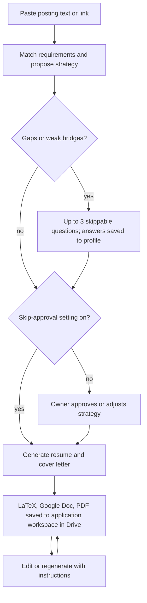
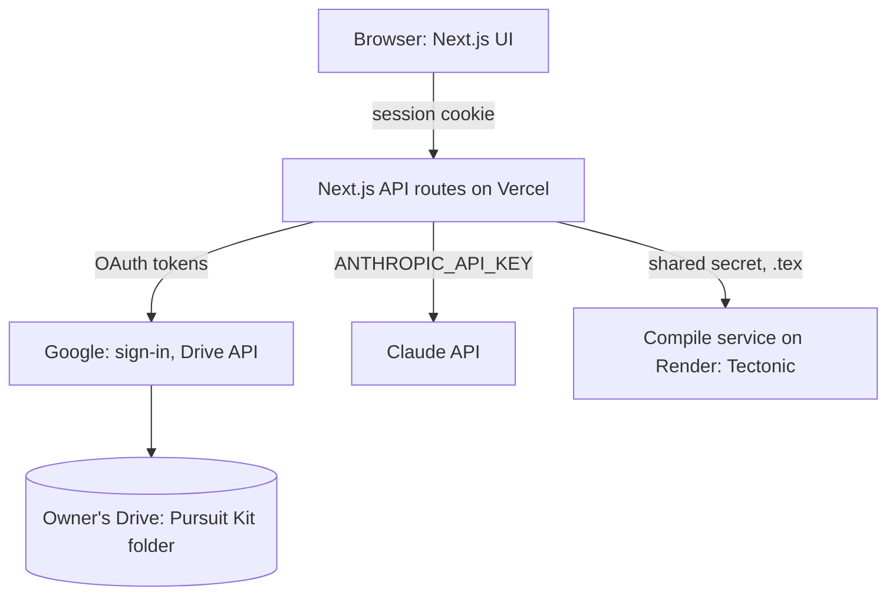
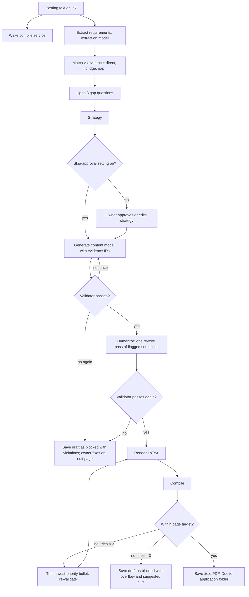

# Pursuit Kit MVP - Plan

## Goal Capsule

- **Objective:** For any job posting, the owner can go from pasting the posting to a submit-ready tailored resume and cover letter in under 10 minutes, with every claim traceable to their own recorded evidence, and can see all their applications and their next steps in one place.
- **Product authority:** This plan covers the MVP stage only, used by a single person (the owner). Multi-user access, payments, critique and scoring, company research, notifications and the other later stages listed under How This Work Fits Together are not active scope.
- **Means:** A Next.js app on Vercel with Google sign-in and Drive storage, Claude for extraction and writing with code-enforced evidence links, and a Tectonic compile service on Render (KTD1–KTD6, ADRs in `docs/adr/`).
- **Authority:** The Product Contract wins on product behavior; KTDs win on implementation mechanism within the cited Rs; the ADRs record why each KTD was chosen and must be updated in the same change if a KTD changes.
- **Execution profile:** Greenfield, one pull request, units in dependency order (U1 → U10). No person-review rule exists in the repo, so size does not justify a split.
- **Stop conditions:** Stop and ask if a free-tier limit makes a KTD infeasible (for example, the Vercel function limit cannot hold a generation step even when split), or if meeting a requirement would need a wider Google scope than `drive.file`.
- **Finishes the work:** `ce-work` builds and verifies locally; deploying to Vercel and Render and creating the Google OAuth client need the owner's accounts and are listed under Operational Notes.
- **Open blockers:** None.

---

## Product Contract

### Summary

Pursuit Kit is a personal web app for job applications, built for freshers and experienced professionals without an academic background.
The owner signs in with Google and seeds a career profile from whatever they have: a resume, a LinkedIn export, project documents and links.
For each job posting, the app matches requirements to evidence, asks a few targeted gap questions, agrees a framing strategy with the owner, and produces a tailored resume and cover letter as LaTeX, Google Doc and PDF, all stored in the owner's Google Drive and tracked per application.

### Problem Frame

Tailoring a resume and cover letter for each job by hand takes long enough that people either send a generic resume or apply to fewer jobs.
Generic AI writing tools are fast but invent achievements, inflate ownership, and produce text that reads as machine-written, so the output still needs careful hand-checking.

The reference system (claude-resume-kit) solves the accuracy problem with an evidence base and claim rules, but it is built around academic careers: papers, venues, authorship order, publication status.
Freshers have thin evidence (projects, internships, coursework), and experienced industry professionals have evidence in roles, tickets, reviews and shipped work.
Neither fits a papers-first model, and both need to get through an application quickly rather than spend hours building a knowledge base first.

### Key Decisions

- **MVP is the core loop plus an application tracker.** Critique scoring, the approved edit-plan loop and company research wait for later stages. (session-settled: user-directed — chosen over core loop alone, core loop plus critique, and a resume-plus-JD-only thin version: the tracker gives day-to-day value from the first application.) Governs R19, R20.
- **The profile grows from each job posting rather than being built up front.** Import is quick, and gap questions at each posting fill in evidence where real jobs need it. (session-settled: user-approved — chosen over a full achievement library at onboarding: up-front building costs hours and freshers have little to put in.) Governs R4, R8, R12.
- **Google sign-in, restricted to an allowlist, ships in the MVP, and the owner's Google Drive is the storage.** A public URL without login would expose career data and let anyone spend the AI budget; the same sign-in later becomes multi-user login. (session-settled: user-approved — chosen over app-database storage behind a password, and download-only output.) Governs R1–R3.
- **The app is the master copy of every document.** LaTeX, Google Doc and PDF are regenerated together from the app's content; hand edits in Drive are not read back. (session-settled: user-approved — chosen over LaTeX-as-master or Google-Doc-as-master.) Governs R17, R18.
- **Outputs are LaTeX, Google Doc and PDF.** (session-settled: user-directed — chosen over Doc plus PDF, PDF only, Doc only, or Doc plus PDF plus DOCX.) Governs R13.
- **The owner's own AI key pays for generation in the MVP.** How other users pay (their own key, or per-resume or usage charges) is decided at the multi-user stage. (session-settled: user-directed — chosen over owner-pays-always and free-tier-only models.) Governs R21.
- **Cover letters use only the job posting and owner-supplied notes, with no web research.** This keeps runs inside the 10-minute target. (session-settled: user-approved — chosen over a light web lookup with cited or UNVERIFIED facts.) Governs R12, R16.
- **The accuracy rules from the reference system carry over, rewritten for workplace evidence.** Accuracy outranks relevance, impact, keyword match and brevity, in that order. Governs R6, R7, R16.

### Actors

- A1. Owner: the single signed-in user in the MVP; supplies evidence, approves strategy, receives documents.
- A2. AI writer: the language model that extracts evidence, matches requirements, and drafts documents, always constrained by the owner's evidence and claim rules.
- A3. Google Drive: the owner's storage for profile data, application workspaces and generated files.

### Requirements

**Access and storage**

- R1. The app requires Google sign-in and admits only email addresses on an allowlist, which in the MVP holds only the owner's email.
- R2. All profile data, application workspaces and generated documents are stored in a dedicated app folder in the signed-in user's Google Drive.
- R3. When the app cannot find an expected file in its Drive folder (for example, because it was renamed or deleted by hand), it tells the owner which application or profile item is affected instead of failing silently.

**Career profile**

- R4. The owner can seed the profile from any combination of four optional sources: an existing resume (PDF or DOCX), a LinkedIn data export, uploaded project documents (writeups, performance reviews, certificates), and links (GitHub, portfolio, project pages).
- R5. From each source the app extracts roles, projects, education, skills, tools, measurable results and dates, and shows the owner what it extracted so they can correct or delete items before they are saved.
- R6. Each evidence item records the owner's personal contribution as distinct from the team's, and is classified as safe to claim, needs hedging, or do not claim.
- R7. The owner can maintain claim rules: a per-item description of how something may and may not be described, plus a do-not-claim list. Generation never uses anything those rules exclude.
- R8. An optional guided interview is available at any time. It asks, per role or project, what the owner personally did, which tools they used, what numbers resulted, who else was involved, and what must never be claimed, and saves the answers as evidence.
- R9. The profile holds the owner's fixed details used on every output: contact details, profile links, education, and a work-authorization or relocation line.

**Per-job run**

- R10. The owner starts a job run by pasting job posting text or a link. When a link cannot be read, the app says so and asks for the pasted text.
- R11. The app labels each requirement in the posting as a direct match, a bridge (with confidence), or a gap against the profile, extracts ATS keywords, and proposes a framing strategy: the lead narrative, what to emphasise, and what to downplay.
- R12. Where it finds gaps or weak bridges, the app asks at most three targeted questions. Each is skippable, and each answer is saved to the profile as evidence for future runs. The owner may also paste free-text notes about the company for the cover letter to use.
- R13. After the owner approves the strategy, the app generates a tailored resume and a cover letter, each as a LaTeX source, a Google Doc, and a PDF, saved in that application's Drive workspace with submit-ready names (for example `Firstname_Lastname_Resume.pdf`).
- R14. The owner can skip the approval step with a setting; the app then uses its proposed strategy directly.
- R15. The resume is one page for owners without full-time work experience and at most two pages for experienced owners, and the PDF never runs over the target.
- R16. Generated text passes a "sounds human" check that removes typical AI phrasing, and the cover letter makes no claim that the resume and evidence do not support.

**Editing**

- R17. The owner can edit any generated bullet or paragraph in the app, or regenerate with free-text instructions such as "lead with the payments project" or "shorten the summary". Every change regenerates all three formats together.
- R18. Before regenerating, the app warns that any hand edits made directly to the Google Doc will be overwritten.

**Application tracker**

- R19. Each job run creates an application workspace holding the posting, the agreed strategy, the generated documents, and a status (draft, applied, interview, offer, rejected), an optional deadline, and a free-text next step.
- R20. The owner sees a list of all applications with status, deadline and next step, and can reopen any application to pick up where they left off.

**Operation**

- R21. AI generation runs on the owner's own API key, held server-side and never shown in the browser.



### Key Flows

- F1. First-time setup
  - **Trigger:** Owner opens the app for the first time.
  - **Actors:** A1, A2, A3
  - **Steps:** Sign in with Google; app creates its Drive folder; owner adds fixed details and uploads any of the four sources; app shows extracted evidence; owner corrects it and marks do-not-claim items.
  - **Outcome:** A profile exists that is good enough to start a first job run, in about 15 minutes.
  - **Covered by:** R1, R2, R4, R5, R6, R7, R9
- F2. Tailored application
  - **Trigger:** Owner pastes a posting.
  - **Actors:** A1, A2, A3
  - **Steps:** Match and strategy; gap questions; approval (unless skipped); generation; review; optional edits.
  - **Outcome:** A resume and cover letter ready to submit, plus a tracker entry with status draft.
  - **Covered by:** R10–R18, R19
- F3. Tracking
  - **Trigger:** Owner submits an application or hears back.
  - **Actors:** A1
  - **Steps:** Open the application list; update status, deadline or next step.
  - **Outcome:** The list shows the current state of every application.
  - **Covered by:** R19, R20

### Acceptance Examples

- AE1. **Covers R10.** Given the owner pastes a LinkedIn job link that cannot be read without signing in, when the app tries to fetch it, then it shows that the link could not be read and offers a text box for the posting text, without starting the match.
- AE2. **Covers R12.** Given a posting requires Kubernetes and the profile has no Kubernetes evidence, when matching runs, then the app asks one question about Kubernetes use. If the owner skips it, Kubernetes stays a gap and is not claimed. If the owner answers "deployed services to a Kubernetes cluster during my Acme internship", that answer is saved as evidence on the Acme internship and is available to this and later runs.
- AE3. **Covers R12.** Given matching finds six gaps, when questions are asked, then no more than three are shown, chosen by how much each gap matters to the posting.
- AE4. **Covers R6, R7, R16.** Given an evidence item is marked "needs hedging" because the owner co-built a feature with two teammates, when a bullet uses it, then the bullet uses a shared verb (for example "co-built" or "contributed to") rather than an ownership verb (for example "built" or "led").
- AE5. **Covers R7.** Given the owner put a client's name on the do-not-claim list, when any document is generated, then the client's name appears in neither the resume nor the cover letter.
- AE6. **Covers R14.** Given the skip-approval setting is on, when the owner pastes a posting with no gaps, then documents are generated without the owner being asked anything.
- AE7. **Covers R15.** Given the owner has no full-time work experience, when the resume is generated, then the PDF is exactly one page.
- AE8. **Covers R17, R18.** Given the owner edited the Google Doc directly in Drive, when they ask the app to regenerate, then the app warns that the Doc edits will be overwritten. If they continue, all three formats reflect the app's content.
- AE9. **Covers R3.** Given the owner deleted (or trashed) the data file in Drive that holds an application's posting, when they open that application, then the app names the missing file and the application it belongs to.
- AE10. **Covers R1.** Given someone signs in with a Google account not on the allowlist, when sign-in completes, then they see an access-denied message and no data or AI features.

### Success Criteria

- With a profile already in place, the median time from pasting a posting to having submit-ready PDFs is under 10 minutes, including the approval step and one regenerate.
- First-time setup from an existing resume takes about 15 minutes.
- Across the owner's first ten real applications, no generated document contains a claim the owner has to remove because it is false or inflated.
- The owner prefers the result to tailoring by hand, measured by actually using it for those ten applications.

### Scope Boundaries

**Deferred for later**

- Independent critique: simulated readers, score out of 100, ranked fixes, score history.
- Approved edit-plan loop with before/after metrics and edit history.
- Company web research and fact-checked cover-letter hooks.
- Academic CV format and publication lists.
- Role-type profiles and routing rules beyond the strategy proposed per posting.
- DOCX output, plain-text output, and prefilled answers for application forms.
- Interview preparation, outreach messages, and follow-up emails.
- Email or other notifications and deadline reminders.
- Analytics across applications and outcome learning.
- Versioning of which profile state produced which application.
- More than one user, more than one persona per user, removing the allowlist.
- Other users paying (their own key, per-resume, or usage charges).
- Finding jobs or importing from job boards in bulk.

**Outside this product's identity**

- Writing claims the owner cannot support with evidence, even on request.

<!-- ce-section: work-relationships -->
### How This Work Fits Together

This plan covers the MVP stage: one owner, the core loop and the tracker. The stages below are the current understanding, not a committed roadmap.

- Stage 2: quality loop (critique, scoring, edit plan, company research). Depends on this MVP's generation and evidence model.
- Stage 3: open access (remove allowlist, multiple users, notifications). Depends on this MVP's Google sign-in and per-user Drive storage. Shares the payment question.
  - Payment model (bring-your-own key or charging per resume or usage). Still to decide.
- Stage 4: broader outputs and outreach (DOCX, form answers, interview prep, outreach messages). Can proceed independently of stage 2.

### Dependencies / Assumptions

- Hosting is a free tier; it must allow server-side secrets (the AI key) and calls to Google and the AI provider.
- The owner has a Google account and an AI provider API key.
- Generating LaTeX-based PDFs is possible within the chosen free hosting, either on the server or through an external service.
- Many job boards block automated reading of their links, so pasted text is the reliable path (handled by R10).

### Outstanding Questions

Hosting, AI provider, LaTeX compilation, Drive layout and scope, and Google Doc production are resolved by KTD1–KTD6. The remaining items are deferred to implementation:

**Deferred to Implementation**

- The exact resume and cover-letter template design (one clean single-column template each; U7 chooses it).
- The banned-phrase list for the "sounds human" check (U3 starts from a seed list and grows it from real outputs).

### Sources / Research

- Reference system: claude-resume-kit functional inventory (sections A–L) supplied by the owner in the brainstorm session; the MVP adapts its evidence capture (A), per-job strategy (D), content selection (E), generation (F), cover letter (G), workspace (J) and accuracy principles (K) for non-academic careers.
- Google Drive scopes: `drive.file` is non-sensitive and limits access to files the app creates or the user opens through the Picker ([Choose Google Drive API scopes](https://developers.google.com/workspace/drive/api/guides/api-specific-auth)). Shapes KTD3.
- LaTeX on edge runtimes: Workers cannot run native TeX; the common pattern is a containerized Tectonic service over HTTP ([Why a LaTeX compiler can't run on Cloudflare Workers](https://zeli.app/story/50149609), [Tectonic](https://tectonic-typesetting.github.io/en-US)). Shapes KTD1, KTD5.
- Free tiers: Render free web services sleep after 15 minutes idle and wake in up to about a minute; Vercel Hobby keeps the frontend warm ([Render vs Vercel](https://render.com/docs/render-vs-vercel-comparison), [Render free tiers 2026](https://render.com/articles/platforms-with-a-real-free-tier-for-developers-in-2026)). Vercel's exact Hobby function limit was reported inconsistently (60–300 seconds) and must be checked at deploy time. Shapes KTD1.
- Drive conversion: uploading a supported file with the Google Docs target type converts it on upload ([community thread](https://community.latenode.com/t/how-to-transform-word-documents-to-google-docs-format-via-drive-api-v3/26343)). Shapes KTD6.

Product Contract preservation: restructured, no scope change — Outstanding Questions resolved in place by KTD1–KTD6; AE9 reworded to name the data file that holds the posting and to include trashed files; the R14 flowchart node relabelled to match the skip-approval setting.

---

## Planning Contract

### Key Technical Decisions

- KTD1. **Next.js (TypeScript, App Router) on Vercel Hobby, plus a separate Tectonic compile service on Render's free tier.** The UI stays warm while TeX runs in a container; the app wakes the compile service when a posting is pasted. See `docs/adr/0001-hosting-vercel-app-render-compile-service.md`. Serves R13, R15 and the 10-minute success criterion.
- KTD2. **Auth.js Google provider with an `ALLOWED_EMAILS` check in the sign-in callback, and cookie-only sessions with no database.** Google tokens live in the encrypted session cookie and are refreshed server-side. See `docs/adr/0002-google-sign-in-allowlist-cookie-session.md`. Instantiates the sign-in Key Decision (session-settled: user-approved — chosen over app-database storage behind a password, and download-only output: one Google grant covers login and Drive). Governs R1.
- KTD3. **Only the `drive.file` scope; a visible `Pursuit Kit` folder with `_data/*.json` files and one subfolder per application.** Whole-file writes with a `modifiedTime` check before overwrite. See `docs/adr/0003-drive-file-scope-and-visible-data-layout.md`. Governs R2, R3.
- KTD4. **Claude API through one AI module, with schema-validated JSON for every step and evidence IDs on every claim, enforced by a deterministic validator.** Extraction model defaults to `claude-haiku-5-5`, writing model to `claude-sonnet-5-5`, both configurable. See `docs/adr/0004-claude-api-structured-generation-with-evidence-links.md`. Governs R6, R7, R16, R21.
- KTD5. **One LaTeX template per document type, compiled by Tectonic, with a page-fit loop of at most three AI trims.** See `docs/adr/0005-tectonic-latex-compile-and-page-fit-loop.md`. Governs R13, R15.
- KTD6. **Google Doc made by uploading generated HTML with the Google Docs target type; regenerate updates the same Doc; `modifiedTime` detects hand edits.** See `docs/adr/0006-google-doc-via-html-conversion.md`. Governs R13, R18.
- KTD7. **One content model is the source of all three formats.** Each application stores the generated content (summary, skills, positions with bullets, cover-letter paragraphs, each with evidence IDs) in `application.json`; LaTeX, HTML and the Doc are pure renders of it. Instantiates the master-copy Key Decision. Governs R17.
- KTD8. **Long steps are separate requests driven by the browser.** Match, gap questions, strategy, generate, humanize, each fit attempt (one compile plus at most one trim) and save each run as their own API call, saving their output to `application.json` before returning. No single function call approaches the Vercel limit, the browser shows progress, and a reload resumes from the last saved step.
- KTD9. **Tests mock the AI module and Google APIs with recorded fixtures; one integration test runs the real compile service in Docker.** Vitest for units, Playwright for the core flow against mocks.

### High-Level Technical Design

Component topology:



Per-job pipeline and where each guard sits:



Application status lifecycle (R19): `draft → applied → interview → offer`, with `rejected` reachable from `applied` or `interview`. The owner may also set any status by hand; the app does not block transitions.

### Output Structure

```text
package.json
tsconfig.json
.gitignore
next.config.ts
vitest.config.ts
playwright.config.ts
.env.example
src/
  auth.ts
  middleware.ts
  app/
    page.tsx                      applications list (tracker)
    signin/page.tsx
    denied/page.tsx
    profile/                      import, review, fixed details, claim rules, interview
    applications/new/page.tsx     paste posting
    applications/[id]/            match, questions, strategy, documents, edit
    api/                          route handlers per step
  lib/
    auth/                         allowlist, tokens
    drive/                        client, store, schemas, errors, docs, upload
    applications/                 tracker
    profile/                      interview, rules
    ai/                           client, prompts, schemas
    claims/                       validator, humanize
    import/                       resume, linkedin, docs, links, extract
    jobs/                         intake, match, strategy
    generate/                     content, fit, pipeline, edit
    render/                       latex, html, templates/
    compile/                      compile-service client, wake
services/
  compile/
    Dockerfile
    server.ts
    server.test.ts
    render.yaml
tests/
  fixtures/                       recorded AI and Drive responses, sample resume, LinkedIn zip, postings
  e2e/core-loop.spec.ts
```

### Assumptions

- The owner creates a Google Cloud OAuth client (Web) with the `drive.file` scope, adds the Vercel URL as a redirect URI, and sets the consent screen's publishing status to "In production". The app requests only non-sensitive scopes, so no Google verification is needed, and `ALLOWED_EMAILS` (KTD2) is the access gate. Leaving it in "Testing" would expire refresh tokens every 7 days and force a weekly sign-in.
- A resume PDF has a text layer. Scanned image-only PDFs are out of scope for extraction; the app says no text was found and suggests the LinkedIn export or the interview.
- LinkedIn's data export is a zip of CSV files (`Profile.csv`, `Positions.csv`, `Education.csv`, `Skills.csv`, and others); U4 parses the ones present and ignores the rest.

### Risks

| Risk | Mitigation |
|---|---|
| Render compile service asleep when needed, adding up to a minute | Wake on paste and on strategy, documents and edit page loads; compile client waits for a slow wake (KTD1, U6, U7); Cloud Run fallback in ADR 0001 |
| Vercel function time limit lower than a generation step | One step per request (KTD8); stop condition in Goal Capsule |
| Vercel 4.5 MB request body limit blocks large uploads | File bytes go straight from the browser to Drive through a resumable upload session (U4) |
| AI returns claims without evidence | Validator rejects and regenerates once, then shows violations (KTD4) |
| Unescaped user text breaks LaTeX | Escaping in the renderer with tests for every special character (U7) |
| Google refresh token missing (no offline consent) | Request offline access with consent prompt on first sign-in; re-prompt when refresh fails (U1) |
| Hand edits in Drive overwritten | Warning before regenerate (R18, KTD6) |

---

## Implementation Units

| U-ID | Title | Key files | Depends on |
|---|---|---|---|
| U1 | Scaffold, sign-in, allowlist | `src/auth.ts`, `src/middleware.ts` | none |
| U2 | Drive store | `src/lib/drive/` | U1 |
| U3 | AI module and claim validator | `src/lib/ai/`, `src/lib/claims/` | U1 |
| U4 | Profile import and review | `src/lib/import/`, `src/app/profile/` | U2, U3 |
| U5 | Claim rules and guided interview | `src/app/profile/`, `src/lib/ai/prompts/` | U4 |
| U6 | Job intake, match, gap questions, strategy | `src/lib/jobs/`, `src/app/applications/` | U2, U3, U4 |
| U7 | LaTeX templates, compile service, page fit | `services/compile/`, `src/lib/render/`, `src/lib/compile/` | U1, U3 |
| U8 | Generate and save documents | `src/lib/generate/`, `src/lib/render/html.ts` | U2, U3, U6, U7 |
| U9 | Editing and regenerate | `src/app/applications/[id]/` | U8 |
| U10 | Application tracker | `src/app/page.tsx` | U2, U6 |

### U1. Scaffold, sign-in, allowlist

**Goal:** A Next.js TypeScript app where only allowlisted Google accounts can sign in and every page and API route requires a session.

**Requirements:** R1, R21 (key held server-side); AE10. Governs via KTD2.

**Dependencies:** none

**Files:**
- `package.json`, `next.config.ts`, `tsconfig.json`, `vitest.config.ts`, `playwright.config.ts`, `.env.example`, `.gitignore`
- `src/auth.ts`, `src/middleware.ts`, `src/app/layout.tsx`, `src/app/signin/page.tsx`, `src/app/denied/page.tsx`
- `src/lib/auth/allowlist.ts`, `src/lib/auth/tokens.ts`
- Test: `src/lib/auth/allowlist.test.ts`, `src/lib/auth/tokens.test.ts`

**Approach:**
1. Set up Next.js App Router, TypeScript strict, ESLint, Prettier, Vitest, Playwright, and npm scripts `lint`, `typecheck`, `test`, `test:e2e`, `test:compile` (U7 defines what `test:compile` runs).
2. Configure Auth.js Google provider with `openid email profile` and `drive.file`, offline access, consent prompt (KTD2).
3. Admit a sign-in only when Google reports the email as verified and the lowercased email is in `ALLOWED_EMAILS`; route everyone else to `/denied`.
4. Store access token, refresh token and expiry only in the encrypted JWT and read them server-side; the session object sent to the browser carries only the email and a refresh-error flag. Refresh when expired; on refresh failure, end the session and ask the owner to sign in again.
5. Middleware protects every route except sign-in, denied and auth callbacks. API routes also check the session themselves.
6. `.env.example` lists `AUTH_SECRET`, `AUTH_GOOGLE_ID`, `AUTH_GOOGLE_SECRET`, `ALLOWED_EMAILS`, `ANTHROPIC_API_KEY`, `AI_EXTRACTION_MODEL`, `AI_WRITING_MODEL`, `COMPILE_SERVICE_URL`, `COMPILE_SERVICE_SECRET`.

**Patterns to follow:** Auth.js v5 Next.js guide.

**Test scenarios:**
- Covers AE10. An email not in `ALLOWED_EMAILS` is rejected by the allowlist check.
- An allowlisted email in different letter case (`Owner@Gmail.com`) is accepted.
- An empty `ALLOWED_EMAILS` rejects everyone.
- An allowlisted email that Google reports as unverified is rejected.
- The session object returned to the browser contains no access or refresh token.
- A token past expiry triggers a refresh and returns the new access token and expiry.
- A failed refresh returns an error state that ends the session.

**Verification:** Signing in with a non-allowlisted account lands on the denied page; an unauthenticated request to any API route returns 401.

### U2. Drive store

**Goal:** A typed data layer that creates the app folder and reads and writes profile, evidence, applications and documents in the owner's Drive.

**Requirements:** R2, R3; AE9. Governs via KTD3.

**Dependencies:** U1

**Files:**
- `src/lib/drive/client.ts` (authenticated Drive client from the session)
- `src/lib/drive/store.ts` (bootstrap folder, read/write JSON, upload binary, create subfolder, find by ID)
- `src/lib/drive/schemas.ts` (Zod schemas with `schemaVersion` for index, profile, evidence, applications, application)
- `src/lib/drive/errors.ts` (`MissingFileError` naming the affected item)
- Test: `src/lib/drive/store.test.ts`, `src/lib/drive/schemas.test.ts`

**Approach:**
1. On first authenticated request, find the app-created `Pursuit Kit` folder or create it with `_data/`, `_data/sources/` and `Applications/`, and write `index.json`.
2. JSON reads validate against the schema; writes replace the whole file after checking `modifiedTime` matches what was read (KTD3).
3. A 404 from Drive, or a file returned with `trashed: true`, becomes `MissingFileError` carrying the item type and name (application company and role, or profile file). Every read requests the `trashed` field, and the folder search filters `trashed = false`.
4. Application folders are named `YYYY-MM-DD Company - Role`.

**Test scenarios:**
- First run with no folder creates the full layout and `index.json` with folder IDs.
- Second run finds the existing folder and creates nothing new.
- A trashed `Pursuit Kit` folder is ignored by the bootstrap search, and a new folder is created.
- Reading `profile.json` that fails schema validation raises a clear error naming the file.
- Writing when `modifiedTime` changed since read refuses with a conflict error.
- Covers AE9. Reading an application whose `application.json` returns 404 raises `MissingFileError` naming that application's company and role.
- Covers AE9. Reading an application whose `application.json` comes back with `trashed: true` raises the same error.
- Folder name for company `A&B Corp` and role `Dev/Ops` is sanitised to a valid name.

**Verification:** With mocked Drive responses, all store operations pass; a manual run against a real Drive creates the folder tree.

### U3. AI module and claim validator

**Goal:** One module for all Claude calls returning schema-checked results, plus the deterministic validator and "sounds human" scan that every generated text passes.

**Requirements:** R6, R7, R16, R21; AE4, AE5. Governs via KTD4.

**Dependencies:** U1

**Files:**
- `src/lib/ai/client.ts` (Anthropic SDK wrapper: model role, schema, one retry on invalid JSON, typed errors)
- `src/lib/ai/schemas.ts`
- `src/lib/claims/validator.ts`
- `src/lib/claims/humanize.ts` (banned phrase and structure list, scan, report)
- `src/lib/claims/verbs.ts` (ownership verbs vs shared-work verbs)
- Test: `src/lib/ai/client.test.ts`, `src/lib/claims/validator.test.ts`, `src/lib/claims/humanize.test.ts`

**Approach:**
1. `client.ts` exposes `run(role, prompt, schema)`; the model ID comes from env per role; tests inject a fake.
2. Validator input: the generated content model and the evidence set. Every cover-letter sentence carries a source type: an evidence claim (needs evidence IDs and follows every evidence rule), a hook from the posting or owner notes (needs a reference to the posting or notes and may state no fact about the owner), or connective text (no factual claim). Resume bullets are always evidence claims. It reports violations rather than throwing:
   - an evidence claim with no evidence IDs, unknown IDs or do-not-claim IDs;
   - an ownership verb on an item whose contribution is `shared` or whose claim class is `hedge` (`team-led` items may use "led");
   - a number, percentage, currency amount or duration not present in the cited evidence or fixed details;
   - a do-not-claim term anywhere in the text;
   - a cover-letter evidence claim citing evidence the resume does not use.
3. Humanize scan flags banned phrases (seed list: "leveraged", "spearheaded", "passionate about", "in today's fast-paced", "I am excited to", em-dash chains, "not only... but also") and reports them for one rewrite pass.

**Execution note:** Implement the validator test-first; it is the product's accuracy guarantee.

**Test scenarios:**
- A model response that fails the schema is retried once; a second failure returns a typed error, not partial data.
- Covers AE4. A bullet "Built the payments service" citing an item marked shared work is a violation; "Co-built the payments service" passes.
- Covers AE5. A cover letter containing a do-not-claim client name is a violation, even when the bullet's evidence ID is valid.
- A bullet with no evidence IDs is a violation.
- A cited bullet stating "cut latency 40%" when the cited evidence has no 40% figure is a violation.
- A cover-letter hook sentence that references the posting passes without evidence IDs; the same sentence stating a fact about the owner is a violation.
- An ownership verb on a solo item marked `hedge` is a violation (AE4's hedging case).
- A bullet citing an ID not in the evidence set is a violation.
- A cover-letter paragraph citing evidence not used anywhere in the resume is a violation (R16).
- Text containing "spearheaded" is flagged by the humanize scan; the same word inside a quoted company name supplied by the owner is not flagged.
- Clean content returns zero violations.

**Verification:** Validator and scan tests pass; the AI client never runs in tests without the fake.

### U4. Profile import and review

**Goal:** The owner can import any mix of resume, LinkedIn export, documents and links, review what was extracted, correct it, and save fixed details.

**Requirements:** R4, R5, R9; F1.

**Dependencies:** U2, U3

**Files:**
- `src/lib/import/resume.ts` (PDF text via `unpdf`, DOCX text via `mammoth`)
- `src/lib/import/linkedin.ts` (unzip, parse known CSVs)
- `src/lib/import/docs.ts` (PDF, DOCX, TXT, MD project docs)
- `src/lib/import/links.ts` (fetch page, extract readable text; GitHub repo links via the public API: description, languages, README)
- `src/lib/import/extract.ts` (extraction-model call turning text into candidate evidence items)
- `src/lib/drive/upload.ts` (create resumable upload session)
- `src/app/profile/page.tsx`, `src/app/profile/import/page.tsx`, `src/app/profile/review/page.tsx`, `src/app/profile/details/page.tsx`
- `src/app/api/profile/import/route.ts`, `src/app/api/profile/evidence/route.ts`, `src/app/api/profile/details/route.ts`
- Test: `src/lib/import/resume.test.ts`, `src/lib/import/linkedin.test.ts`, `src/lib/import/links.test.ts`, `src/lib/import/extract.test.ts`

**Approach:**
1. Vercel rejects request bodies over 4.5 MB, so file bytes never pass through a function. The import route creates a Drive resumable upload session in `_data/sources/` (passing the browser origin) and returns its URI; the browser uploads straight to Drive, then calls the import route with the new file ID for parsing. The LinkedIn zip is unzipped in the browser and only the known CSVs are uploaded.
2. Extraction produces candidate items (role, project, education, skill, result) with dates, tools and numbers; nothing is saved to `evidence.json` until the owner confirms on the review page (R5). Duplicates from different sources appear as separate candidates the owner can delete.
3. Fixed details (contact, links, education, work-authorization or relocation line, experience level that sets the page target per R15) and the skip-approval setting (R14) are edited on the details page.

**Test scenarios:**
- A text-layer resume PDF fixture yields text containing the candidate's roles.
- A DOCX resume fixture yields the same roles.
- An image-only PDF yields "no text found" and a suggestion, not an empty profile.
- A LinkedIn zip fixture with `Positions.csv` and `Skills.csv` yields positions with dates and a skill list; a zip missing `Skills.csv` still imports positions.
- A non-zip file uploaded as a LinkedIn export is rejected with a clear message.
- A GitHub repo link yields description, languages and README text; an unreachable link reports failure without blocking other sources.
- A 12 MB performance-review PDF uploads through a resumable session without passing through the import route's body.
- Only the known CSVs from a LinkedIn zip are uploaded.
- Candidates are not written to `evidence.json` until confirmed.

**Verification:** Importing the fixture resume and LinkedIn export, then confirming, writes the expected evidence items to the mocked Drive.

### U5. Claim rules and guided interview

**Goal:** The owner records contribution, claim class and claim rules per evidence item, keeps a do-not-claim list, and can run the guided interview at any time.

**Requirements:** R6, R7, R8.

**Dependencies:** U4

**Files:**
- `src/app/profile/evidence/[id]/page.tsx` (contribution, claim class, may/may-not text)
- `src/app/profile/rules/page.tsx` (do-not-claim list)
- `src/app/profile/interview/page.tsx`
- `src/lib/ai/prompts/interview.ts`
- `src/app/api/profile/interview/route.ts`
- Test: `src/lib/profile/interview.test.ts`, `src/lib/profile/rules.test.ts`

**Approach:**
1. Every evidence item has `contribution` (solo, shared, team-led), `claimClass` (safe, hedge, do-not-claim) and free-text `mayClaim` / `mayNotClaim`. New items default to `hedge` until the owner sets them.
2. The interview walks roles and projects one at a time, asks the R8 questions with the writing model, and turns answers into evidence updates the owner confirms.
3. The do-not-claim list holds terms (client names, internal project names, figures) checked by the validator (U3).

**Test scenarios:**
- A new evidence item defaults to claim class `hedge`.
- Marking an item `do-not-claim` excludes it from the evidence set passed to generation.
- An interview answer "I wrote the API, Priya did the frontend" produces a proposed update with contribution `shared` and a result attributed to the owner only.
- Skipping an interview question leaves the item unchanged.
- Adding a do-not-claim term persists it to `profile.json`.

**Verification:** Rules set in the UI are visible to the validator on the next generation.

### U6. Job intake, match, gap questions, strategy

**Goal:** From pasted text or a link, the app extracts requirements, matches them to evidence, asks up to three gap questions, and proposes a strategy the owner approves or skips.

**Requirements:** R10, R11, R12, R14; F2; AE1, AE2, AE3, AE6.

**Dependencies:** U2, U3, U4

**Files:**
- `src/lib/jobs/intake.ts` (link fetch and readable-text extraction; detection of sign-in walls and empty pages)
- `src/lib/jobs/match.ts`, `src/lib/jobs/questions.ts`, `src/lib/jobs/strategy.ts`
- `src/app/applications/new/page.tsx`, `src/app/applications/[id]/match/page.tsx`, `src/app/applications/[id]/questions/page.tsx`, `src/app/applications/[id]/strategy/page.tsx`
- `src/app/api/applications/route.ts`, `src/app/api/applications/[id]/match/route.ts`, `src/app/api/applications/[id]/answers/route.ts`, `src/app/api/applications/[id]/strategy/route.ts`
- `src/lib/compile/wake.ts`
- Test: `src/lib/jobs/intake.test.ts`, `src/lib/jobs/match.test.ts`, `src/lib/jobs/questions.test.ts`

**Approach:**
1. Creating an application writes a draft entry and folder (U2) and sends the compile-service wake call with Next.js `after()`, so it goes out after the response without delaying it (KTD1). The strategy, documents and edit pages send the same wake call when they load.
2. Link intake: fetch server-side; if the response is a sign-in page, blocked, or yields under a minimum amount of text, return "could not read" and show the paste box (R10).
3. Match labels each requirement direct, bridge (with confidence) or gap, and lists ATS keywords by category (R11).
4. Questions: rank gaps and weak bridges by the requirement's importance in the posting, ask at most three (R12). Answers become evidence items attached to the named role or project, with claim class `hedge` until the owner changes it; skipped questions leave gaps unclaimed.
5. Questions page: up to three questions, each with an answer box and Skip, plus one free-text company-notes box saved to `application.json` for the cover letter (R12).
6. Strategy page: lead narrative, emphasise list, downplay list and cover-letter hooks (drawn only from the posting and owner notes) shown as editable fields; Approve saves the edited values as the agreed strategy. If the skip-approval setting is on, continue straight to generation (R14).

**Test scenarios:**
- Covers AE1. A link fixture returning a LinkedIn sign-in page produces "could not read" and no match is started.
- A link fixture with a normal job page yields the posting text.
- Pasted text skips fetching entirely.
- Covers AE3. Six gaps produce exactly three questions, the three highest-ranked.
- Covers AE2. Skipping the Kubernetes question keeps Kubernetes as a gap in the match and in generation input; answering it adds an evidence item on the named internship that later runs also see.
- Zero gaps produce zero questions and move to strategy.
- Covers AE6. With skip-approval on and no gaps, the flow proceeds to generation with no owner prompt.
- Creating an application triggers one wake call to the compile service, sent after the response.
- An emphasise item the owner edits on the strategy page is the version passed to generation.
- Company notes entered on the questions page are present in the generation input.

**Verification:** With fixtures, pasting a posting produces a match, questions and strategy, and the application appears as draft in `applications.json`.

### U7. LaTeX templates, compile service, page fit

**Goal:** Generated content renders to valid LaTeX, compiles to PDF on the Render service, and is trimmed until it fits the page target.

**Requirements:** R13, R15; AE7. Governs via KTD5.

**Dependencies:** U1, U3

**Files:**
- `services/compile/Dockerfile` (Tectonic image with the template's packages cached at build)
- `services/compile/server.ts` (`POST /compile` with shared-secret check, `GET /health`; returns PDF, page count, or log)
- `services/compile/server.test.ts`
- `services/compile/render.yaml` (Render blueprint, free plan)
- `src/lib/render/latex.ts` (escape and fill templates)
- `src/lib/render/templates/resume.tex`, `src/lib/render/templates/cover-letter.tex`
- `src/lib/compile/client.ts` (timeout and retry that allow for a cold wake of about 60 seconds)
- `src/lib/compile/wake.ts`
- `src/lib/generate/fit.ts` (loop: compile, compare to target, trim via writing model, up to three tries)
- Test: `src/lib/render/latex.test.ts`, `src/lib/generate/fit.test.ts`

**Approach:**
1. Templates are single-column and ATS-friendly (real text, no tables for layout, standard section headings).
2. `latex.ts` escapes `\ & % $ # _ { } ~ ^` in every inserted value and handles Unicode names via the font setup.
3. The compile service rejects requests without the secret, limits source size, runs Tectonic in a temp directory with a timeout, and returns the page count read from the PDF.
4. Fit per KTD5 and KTD8: each fit attempt is its own request (compile, and if over target, trim one lowest-priority bullet and re-run the validator). A trim that would remove the last resume use of evidence the cover letter cites is skipped in favour of the next-lowest bullet. Target is one page when the profile has no full-time experience, otherwise two.
5. The Docker build copies the templates from `src/lib/render/templates/` into the image and compiles them once, so their packages are cached; any template change requires rebuilding the image.

**Test scenarios:**
- Every LaTeX special character in a company name, bullet and URL is escaped and the result compiles.
- A name with accented characters (`José Müller`) compiles and appears correctly.
- The compile service returns 401 without the secret.
- Invalid LaTeX returns the compiler log, not a 500 with no detail.
- `/health` returns 200 quickly.
- Covers AE7. In the Docker integration test, a fresher content fixture that overflows to two pages is trimmed and ends at exactly one page.
- A fit loop that still overflows after three tries returns the overflow and the suggested cuts instead of looping again, and no over-target PDF is saved (R15).
- An experienced-owner fixture at 1.5 pages is accepted without trimming.
- A trim never removes the only resume bullet behind evidence the cover letter cites.
- The compile client succeeds when the service answers after a 50-second wake.
- The Docker integration test records compile time with the CPU limited to roughly the free-tier level, so the fit budget is known.

**Execution note:** Prove the compile service with the Docker integration test before wiring the app to it.

**Verification:** The Docker image builds, the integration test passes, and the sample resume compiles to the expected page count.

### U8. Generate and save documents

**Goal:** After strategy approval, the app writes the tailored resume and cover letter as one content model, validates it, renders all three formats, and saves them to the application folder.

**Requirements:** R13, R16; F2. Governs via KTD4, KTD6, KTD7.

**Dependencies:** U2, U3, U6, U7

**Files:**
- `src/lib/generate/content.ts` (writing-model call producing the content model with evidence IDs)
- `src/lib/generate/pipeline.ts` (step functions the browser calls in order: generate+validate, humanize+re-validate, fit attempt per document, save)
- `src/lib/render/html.ts` (fixed tag set for Doc conversion)
- `src/lib/drive/docs.ts` (create or update the Google Doc from HTML; record `modifiedTime`)
- `src/app/applications/[id]/documents/page.tsx`
- `src/app/api/applications/[id]/generate/route.ts`, `src/app/api/applications/[id]/humanize/route.ts`, `src/app/api/applications/[id]/fit/route.ts`, `src/app/api/applications/[id]/save/route.ts`
- Test: `src/lib/generate/pipeline.test.ts`, `src/lib/render/html.test.ts`, `src/lib/drive/docs.test.ts`

**Approach:**
1. Generation input: approved strategy, match, evidence excluding do-not-claim items, fixed details, page target.
2. Each step saves the content model to `application.json` before returning (KTD8); the documents page drives the sequence and resumes from the last saved step.
3. Validator violations trigger one regeneration with the violations listed. Persistent violations save the draft as `blocked` with the offending text, and the documents page links to the edit page (U9); no document files are saved.
4. Humanize findings trigger one rewrite pass of the flagged sentences only, then the validator runs again.
5. Fit runs per U7. After three tries the draft is saved as `blocked` with the overflow and suggested cuts, and the documents page links to the edit page.
6. Save runs only when the final content model passes the validator and both documents are within target: `.tex` and PDF uploads and the Doc, named `Firstname_Lastname_Resume` and `Firstname_Lastname_Cover_Letter`.

**Test scenarios:**
- A clean generation saves six artifacts (two `.tex`, two PDF, two Docs) with the expected names.
- A generation with a violation regenerates once; a clean second attempt saves normally.
- Two consecutive violating generations save no document files and leave the draft `blocked` with the violations, openable on the edit page.
- A humanize-flagged sentence is rewritten and the rest of the text is unchanged.
- A humanize rewrite that introduces "led" on a shared item fails the re-validation and no files are saved.
- Reloading the documents page after the generate step resumes at humanize instead of regenerating.
- The uploaded Doc has the Google Docs MIME type (conversion happened).
- HTML render of a content fixture contains only the allowed tags.
- Owner name `Mary-Jane O'Neil` produces a valid file name.

**Verification:** With fixtures and a mocked compile client, the full pipeline saves all files; one manual run against real services produces a submit-ready PDF.

### U9. Editing and regenerate

**Goal:** The owner edits bullets or paragraphs in the app or regenerates with instructions, and all formats update together, with a warning when the Doc was hand-edited.

**Requirements:** R17, R18; AE8. Governs via KTD6, KTD7.

**Dependencies:** U8

**Files:**
- `src/app/applications/[id]/edit/page.tsx`
- `src/app/api/applications/[id]/edit/route.ts`, `src/app/api/applications/[id]/regenerate/route.ts`
- `src/lib/generate/edit.ts`
- Test: `src/lib/generate/edit.test.ts`

**Approach:**
1. In-app edits change the content model directly and the validator runs on edited text. A do-not-claim term blocks saving until removed (R7, AE5); other violations are shown and the owner may keep their own wording. A `blocked` application opens here with its violations or overflow highlighted.
2. Regenerate with instructions sends the current content model, the instruction and the strategy to the writing model.
3. Before either re-render, compare each Doc's `modifiedTime` with the stored value; if newer, require the owner to confirm the overwrite (R18).
4. Re-render runs the same steps as U8, updating files in place. After an in-app edit, an overflow skips the AI trim: the owner sees the overflow and suggested cuts and accepts or rejects each one, so their wording is never changed without consent. Regenerate-with-instructions uses the normal trim loop.

**Test scenarios:**
- Editing one bullet re-renders and replaces the `.tex`, PDF and Doc for that document only.
- "Shorten the summary" changes the summary and leaves bullets' evidence IDs intact.
- Covers AE8. A Doc whose `modifiedTime` is newer than the stored value blocks regeneration until the owner confirms; after confirming, all three formats match the content model.
- An unmodified Doc regenerates with no warning.
- An owner edit that adds an ownership verb to a shared item shows a violation but is saved when the owner keeps it.
- An owner edit containing a do-not-claim client name cannot be saved.
- An owner edit that pushes the resume to two pages for a fresher shows suggested cuts and changes nothing until the owner accepts one.
- A blocked application opens on the edit page and, once fixed, completes render and save.

**Verification:** Edits and regenerates update all three files consistently in the mocked flow.

### U10. Application tracker

**Goal:** A home page listing all applications with status, deadline and next step, each reopening where the owner left off.

**Requirements:** R19, R20; F3.

**Dependencies:** U2, U6

**Files:**
- `src/app/page.tsx`
- `src/app/api/applications/[id]/status/route.ts`
- `src/lib/applications/tracker.ts`
- Test: `src/lib/applications/tracker.test.ts`, `tests/e2e/core-loop.spec.ts`

**Approach:**
1. `applications.json` holds the list; each entry records `resumeStep` (match, questions, strategy, documents, edit), the step to open on reopen. A new draft starts at `match`; a `blocked` application resumes at `edit`.
2. Status, deadline and next step are edited inline; any status can be set (lifecycle in High-Level Technical Design).
3. List sorted by deadline (soonest first, no deadline last), then by last updated.
4. With zero applications, the page shows a short message with links to set up the profile and start a new application.

**Test scenarios:**
- A new application appears as draft with `resumeStep` `match`.
- With zero applications the page shows the profile-setup and new-application links.
- Changing status to `applied` persists and shows in the list.
- An application with a past deadline still lists; ordering puts nearest deadlines first and undated ones last.
- Reopening an application stopped at strategy opens the strategy page.
- An application whose folder is missing shows the R3 message in the list instead of breaking the page.
- End-to-end (mocked AI, Drive and compile): sign in → paste posting → answer one question → approve → documents listed → status set to applied.

**Verification:** The Playwright core-loop test passes against mocks.

---

## Verification Contract

| Gate | Command | Applies to |
|---|---|---|
| Lint | `npm run lint` | all units |
| Types | `npm run typecheck` | all units |
| Unit and integration tests (mocked AI, Drive) | `npm test` | U1–U10 |
| Compile service integration (real Tectonic in Docker) | `npm run test:compile` (builds `services/compile` image and runs `services/compile/server.test.ts` plus the AE7 fit test) | U7, U8 |
| End-to-end core loop (mocks) | `npm run test:e2e` | U10, covers F2 |

U1 creates these scripts; the repo has none today. No test may call the real Claude API or real Google APIs. A manual smoke run against real services (sign in, import a resume, one job run) is recorded in the PR description.

---

## Definition of Done

- All R1–R21 are implemented and each AE1–AE10 is covered by a named test scenario above.
- Every gate in the Verification Contract passes.
- `.env.example` lists every required variable; no secret is committed.
- The six ADRs in `docs/adr/` match what was built; any KTD changed during implementation has its ADR updated in the same change.
- `README.md` explains local setup, the Google OAuth client setup, and deploying the app to Vercel and the compile service to Render.
- No abandoned-attempt code, unused dependencies or commented-out experiments remain in the diff.

### Operational Notes

These steps need the owner's accounts and are not part of `ce-work`'s automated scope:

1. Create a Google Cloud project, enable the Drive API, create a Web OAuth client with the `drive.file` scope, set redirect URIs for localhost and the Vercel domain, and publish the consent screen "In production" (non-sensitive scopes only, so no verification).
2. Deploy `services/compile` to Render's free tier from `render.yaml`; set `COMPILE_SERVICE_SECRET`.
3. Deploy the app to Vercel Hobby; set every variable from `.env.example`; confirm the plan's function time limit fits the longest step.
4. Set `ALLOWED_EMAILS` to the owner's address.
